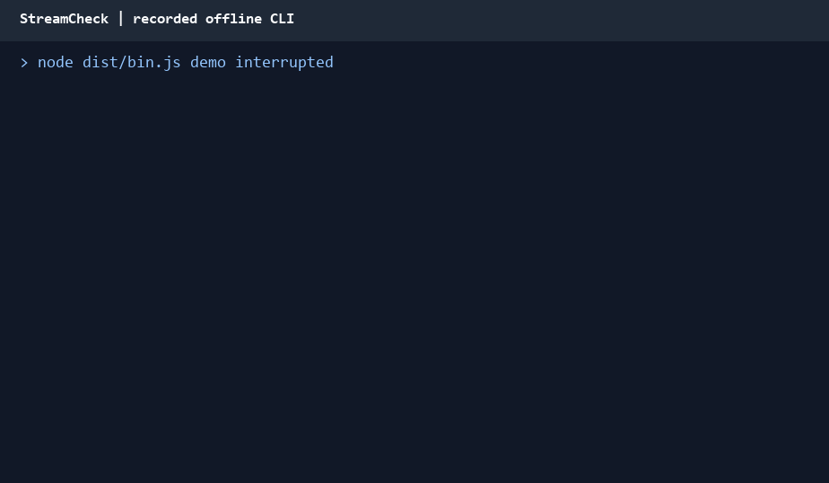

# StreamCheck

[](https://github.com/dannymitchelldev/streamcheck/actions/workflows/ci.yml?query=branch%3Amain)
[](LICENSE)

**Diagnose failed OpenRouter streams without losing the text you already received.**

An HTTP 200 can still end in a failed generation. StreamCheck wraps the official OpenRouter TypeScript SDK with explicit outcomes, timing, and preserved partial text. Use the library in a stream consumer or the CLI to reproduce and inspect failures.



The recording is an actual CLI run against a synthetic HTTP/SSE fixture. Its delays are not live model performance. [Raw recording](docs/demo.cast).

## Try it in five minutes

Node.js **22.12+** and npm are required:

```sh
git clone https://github.com/dannymitchelldev/streamcheck.git
cd streamcheck
npm ci --ignore-scripts
npm run build
node dist/bin.js demo interrupted
```

No API key, provider request, or account setup is needed. Dependency installation uses npm; demos and tests use in-process synthetic HTTP/SSE responses through the real SDK.

The demo intentionally exits **3**:

```text
Webhooks send HTTP notifications when an event

[Offline demo]
Outcome:         Interrupted
First token:     125 ms
Elapsed:         352 ms
Partial output:  Preserved
HTTP status:     200
Failure:         Provider error during streaming
```

Timings vary between runs.

Other scenarios and machine-readable output:

```sh
node dist/bin.js demo success
node dist/bin.js demo auth-failure --json
node dist/bin.js demo rate-limit --json
node dist/bin.js demo interrupted --json
node dist/bin.js --help
```

Human mode sends exact received text to stdout and its summary to stderr. JSON mode sends one complete result to stdout; no streamed fragments, banners, or SDK logs. Use the executable directly when piping JSON; npm script banners are separate from CLI output.

## Library

From another ESM project, install the [GitHub release](https://github.com/dannymitchelldev/streamcheck/releases/tag/v0.1.1):

```sh
npm install --ignore-scripts https://github.com/dannymitchelldev/streamcheck/releases/download/v0.1.1/streamcheck-0.1.1.tgz
```

```typescript
import { runDemo, type RunResult } from 'streamcheck';

const result: RunResult = await runDemo({
  scenario: 'interrupted',
  onText(delta) { process.stdout.write(delta); },
});

if (result.outcome === 'interrupted') {
  console.log(result.error.kind); // provider
  console.log(result.text);       // retained exactly
}
```

In the checkout, run the typed example with `npm run example:demo`. Distribution is through GitHub Releases. The package's `private: true` flag prevents accidental npm registry publication; it does not prevent installation of the release tarball.

The two public operations are:

```typescript
runStreamCheck(options: LiveOptions): Promise<RunResult>
runDemo(options?: DemoOptions): Promise<RunResult>
```

Live options require `apiKey`, `model`, and `prompt`; both operations accept `signal`, `timeoutMs`, and synchronous `onText`. Defaults are a 30,000 ms overall deadline and, for live runs, 256 maximum output tokens. No retries or automatic continuation occur.

An API key that cannot form a valid HTTP authorization header returns an input diagnostic before any request is sent.

## Why these decisions?

| Decision | Reason |
| --- | --- |
| Keep finish reasons provisional while draining | A later observable failure must not become a successful result |
| First accepted terminal outcome wins | Cancellation and deadline races need a deliberate, testable rule |
| Preserve text before calling the consumer | A broken callback must not discard its triggering delta |
| Disable retries | Repeating a partially delivered generation can duplicate output and add charges |
| Let the official SDK parse SSE | Keep the contribution focused on diagnostics and a stable outcome contract |

The [design contract](docs/design.md) describes the edge cases. An [independent AI review](docs/engineering-log.md) caught a false-success case involving another completion choice; the correction has a regression test.

## Explicit live use

Configure `OPENROUTER_API_KEY` in your environment without placing it in source or command-line flags. Select a current model ID from OpenRouter, then run:

```sh
node dist/bin.js run --model <model-id> --prompt "Explain webhooks" --max-tokens 256 --timeout 30000
```

That command explicitly makes a potentially billable request. The library equivalent is `runStreamCheck({ apiKey, model, prompt, signal, onText })`. `npm run example:live -- <model-id>` runs the live TypeScript example. Automated verification never runs either live entry point.

## Results and completion

| Outcome | Meaning | Default CLI exit |
| --- | --- | ---: |
| `success` | Normal completion accepted through the SDK | 0 |
| `failed` | Failure before receiving text | 1 |
| `interrupted` | Failure with received text preserved | 3 |
| `cancelled` | Caller cancellation, with any text preserved | 130 |

Every input/configuration diagnostic exits **2**. Timeout exits **124**, including when its outcome is `interrupted`. `--help` and `--version` exit 0; `--json` applies to run/demo results rather than help/version.

`schemaVersion: 1` results include exact text, timing, observed HTTP status, first finish reason, and warnings. Unknown metadata is `null`. Failed/interrupted results add `error: { kind, phase, message, code? }`; cancellation records `reason: 'caller'`. See the [public TypeScript types](src/types.ts) for every field.

- **Partial output:** true exactly when text is nonempty and normal completion was not accepted. Successful `length` and `content_filter` results set it false and carry `token_limit` / `content_filter` warnings. The flag does not judge answer quality.
- **Completion:** a normal finish reason is provisional while accounting frames drain. A later observable error, conflict, cancellation, or deadline can still win. Identical repeated reasons are harmless. Tool calls are unsupported.
- **Cancellation:** first accepted terminal outcome wins. Deadline and caller-abort handlers record their cause before aborting transport. A pre-aborted signal sends no request. Accepted success survives later cancellation.
- **Callbacks:** each text delta is accumulated before synchronous `onText`. A thrown callback preserves its triggering delta. The first observed finish reason is retained even when a callback throws or cancels on the same frame. Do not pass async callbacks; promises and asynchronous rejections are outside this contract.
- **Timing:** first-token time means time to the first nonempty text delta. It excludes initial module loading and is not a tokenizer measurement. Elapsed time ends when a terminal outcome is accepted, before final cleanup.

## Troubleshooting and limits

| Symptom | Interpretation |
| --- | --- |
| HTTP 401 / 429 | Request failed before streaming: authentication / rate limiting |
| HTTP 200 plus provider diagnostic | Valid provider error arrived inside the stream, possibly before any text |
| Protocol diagnostic | SDK rejected a payload, finish reason was missing/conflicting, or tool calls appeared |
| Timeout after a finish reason | The finish remained provisional while the stream drained |
| Null HTTP status | No response metadata was available; StreamCheck never assumes 200 |

The SDK is pinned to **1.5.91**. It accepts numeric chat-stream error codes; a documented string-code shape is rejected as a protocol error. Received text is still retained. The SDK also hides `[DONE]` and discards unfinished trailing SSE frames: after a valid finish reason, a truncated trailing error may remain undetectable. This is SDK-observed completion, not verified complete transport.

Configured API keys, authorization headers, and raw SDK exceptions are never logged. User prompts and model text are not automatically redacted and may themselves contain secrets. There is no telemetry or output persistence.

Retrying or resuming after partial output can duplicate text and incur additional charges. Local cancellation does not guarantee that a provider stops processing or billing. See [OpenRouter streaming and error handling](https://openrouter.ai/docs/api_reference/streaming).

## Verify and review

```sh
npm run check
npm run example:demo
```

The full check covers types, library/CLI tests, release checks, and a consumer of the actual packed package outside the checkout. It inspects archive contents, LF shebang, relative source maps, ESM exports, declarations, and the installed CLI. Dependency installation may use npm; provider execution uses fixtures and is blocked from network access. Package verification also requires the standard `tar` command.

CI runs **Windows/Ubuntu × Node 22.12.0/24**. [View actual runs](https://github.com/dannymitchelldev/streamcheck/actions/workflows/ci.yml?query=branch%3Amain); release notes link the exact validated commit. macOS, live provider behavior, and physical console Ctrl+C are not established by this matrix.

A separate [live OpenRouter smoke check](docs/verification/live-provider-2026-11-12.json) passed on 2026-11-12 with `openai/gpt-4.1-nano`, StreamCheck v0.1.1, and Windows / Node 24.18.0: HTTP 200, exact marker text, normal stop, and CLI exit 0. This establishes one successful live completion; live failure behavior and sustained reliability remain unverified. [Reproduction steps](docs/testing-runbook.md#live-openrouter-smoke-check).

Built with Codex from a reviewed contract, with a separate AI implementation review and reproduced corrections. Human implementation review is not claimed. The [engineering record](docs/engineering-log.md) separates those stages; the [testing runbook](docs/testing-runbook.md) documents reproducible verification. [Contributions](CONTRIBUTING.md) are welcome under [MIT](LICENSE).
